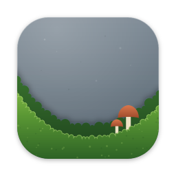

<div align="center">
  
  <h1>DockMoss</h1>
  <p>A macOS menu-bar app that grows moss on Dock icons for apps you haven't opened in a while.<br>
  The longer an app sits unused, the more overgrown its icon gets. Open the app and the moss shrivels away.</p>
  <p>
    <a href="https://github.com/nickatnight/dockmoss/blob/main/package.json"></a>
    <a href="https://github.com/nickatnight/dockmoss/actions/workflows/ci.yml"></a>
    <a href="https://codecov.io/gh/nickatnight/dockmoss"></a>
    <a href="LICENSE"></a>
    <a href="#requirements"></a>
  </p>
  <p></p>
</div>

**Status:** MVP complete (slice 13 of 13). Builds are unsigned; signing, notarization and a DMG are milestone 7.

## Requirements

- macOS 15 or later
- Rust 1.99+, Node 22, pnpm
- Optional: `cargo-deny` and gitleaks 8.30.1 for `pnpm check:task`, `cargo-llvm-cov` for `pnpm coverage`

## Quick start

```sh
pnpm install
pnpm tauri dev
```

Quit any other DockMoss first (an installed copy, a debug bundle, another `tauri dev`). Only one copy runs at a time: a second one hands over to the running copy, which opens Settings, and exits.

DockMoss has no Dock icon. It lives in the menu bar as a moss tile, with Settings… and Quit DockMoss.

## Accessibility access

DockMoss reads the Dock through Accessibility. Which app needs the grant depends on how you start it:

- **`pnpm tauri dev`:** your terminal app.
- **An app bundle:** DockMoss itself. Build one with `pnpm tauri build --debug --bundles app` and run `open src-tauri/target/debug/bundle/macos/DockMoss.app`. macOS asks once, and the menu offers Grant Accessibility Access… until it's granted.

Local builds are ad-hoc signed, so each rebuild counts as a new app and needs a new grant. If the old DockMoss entry in System Settings → Privacy & Security → Accessibility does nothing, remove it with − and relaunch. Granting or revoking takes effect within 5 s, no restart.

## Settings

Open **Settings…** from the menu bar. Every change saves as you make it and reaches the Dock within a second.

| Setting | Default | What it does |
|---|---|---|
| Growth stages | 5 / 10 / 30 days | Days unused before Fuzz, Patchy and Overgrown. Each 2–3650 and longer than the one before. |
| Intensity | 100% | How much of each icon the moss covers. 0% draws none. |
| Fast-forward | 1× | 1×, 10×, 100× or 1000×, to preview growth. |
| Excluded apps | none | Apps that never get moss (up to 256). |
| Launch at login | off | Stored by macOS under System Settings → General → Login Items. Only works from an app bundle. |

## Your data

Everything lives in `~/Library/Application Support/app.dockmoss.DockMoss/`:

- `launch_log.json`: when each app was last used. Quit DockMoss and delete it to start over.
- `settings.json`: quit and delete it to reset every setting.
- `launch_log.json.corrupt`, `launch_log.json.dropped`: copies kept when a file or entry couldn't be read, for recovery by hand. Safe to delete.

Logs go to `~/Library/Logs/app.dockmoss.DockMoss/DockMoss.log`.

Older builds kept their data under `com.dockmoss.app`. A newer build moves it over on its first start; quit the old build before you start the new one.

## Development

```sh
VITE_DOCKMOSS_OVERGROWTH=0.6 pnpm tauri dev   # draw every icon at one overgrowth (0 to 1)
DOCKMOSS_FAST_FORWARD=1000 pnpm tauri dev     # 1, 10, 100 or 1000; overrides the saved speed
```

Dev builds also outline each Dock icon and label it with its overgrowth and stage. `pnpm build` leaves all of this out.

| Command | Runs |
|---|---|
| `pnpm tauri dev` | The app, with Vite on `localhost:5110` |
| `pnpm check` | fmt, clippy in the dev and release profiles, layout guards, `tsc` |
| `pnpm test` | vitest over the frontend's pure modules |
| `pnpm check:task` | `check` plus tests, a clean `pnpm build`, `cargo test`, `cargo deny`, `pnpm audit`, gitleaks |
| `pnpm check:web` | vitest, `pnpm build` and the `dist/` guard |
| `pnpm check:rust-test` | `cargo test` |
| `pnpm check:deps` | `cargo deny` and `pnpm audit` |
| `pnpm check:secrets` | gitleaks |
| `pnpm coverage` | Rust line coverage, on demand, no threshold |
| `pnpm coverage:lcov` | The same, written to `src-tauri/target/lcov.info` |
| `pnpm tauri build` | Unsigned `src-tauri/target/release/bundle/macos/DockMoss.app` |

`pnpm check:task` is `check` (which is `check:fast`) followed by the four parts above, so you can rerun just the part that failed.

[CI](.github/workflows/ci.yml) runs on every PR to `main` and every push to `main`, with Rust pinned to 1.99.1. Its jobs run in parallel:

| Job | Runner | Runs |
|---|---|---|
| Lint | macOS 26 arm64 | `check:fast` |
| Web | Ubuntu 24.04 | `check:web` |
| Deps and secrets | Ubuntu 24.04 | `check:deps`, `check:secrets` |
| Rust tests and coverage | macOS 26 arm64 | `pnpm coverage:lcov` in place of `check:rust-test` (the same tests, minus doctests, which the crate doesn't have), then uploads to Codecov, except on PRs from forks |
| Release build | macOS 26 arm64 | `cargo build` and `pnpm tauri build --no-bundle`; fails on any warning |
| CI | | Passes only when every other job passed. Branch protection should require this one. |

A failed Codecov upload never fails the run. The Codecov CLI is checked against a sha256 kept in `ci.yml`. To update it, change the version and the hash together, and take the hash from both Codecov's `SHA256SUM` and the GitHub release asset.

`tauri dev` skips the Content Security Policy. To test with it, run `pnpm tauri build --debug --no-bundle` and start `src-tauri/target/debug/dockmoss`. That build has the Web Inspector on, so keep it to your own machine.

## Docs

- [ARCHITECTURE.md](ARCHITECTURE.md): how it works, threads, data files, source layout
- [SUMMARY.md](SUMMARY.md): product rules, the last-used algorithm and growth curve
- [CONSTRAINTS.md](CONSTRAINTS.md): the quality bar and what each check enforces
- [CLAUDE.md](CLAUDE.md): engineering conventions
- [src-tauri/icons/README.md](src-tauri/icons/README.md): regenerating the app icon and tray glyph
